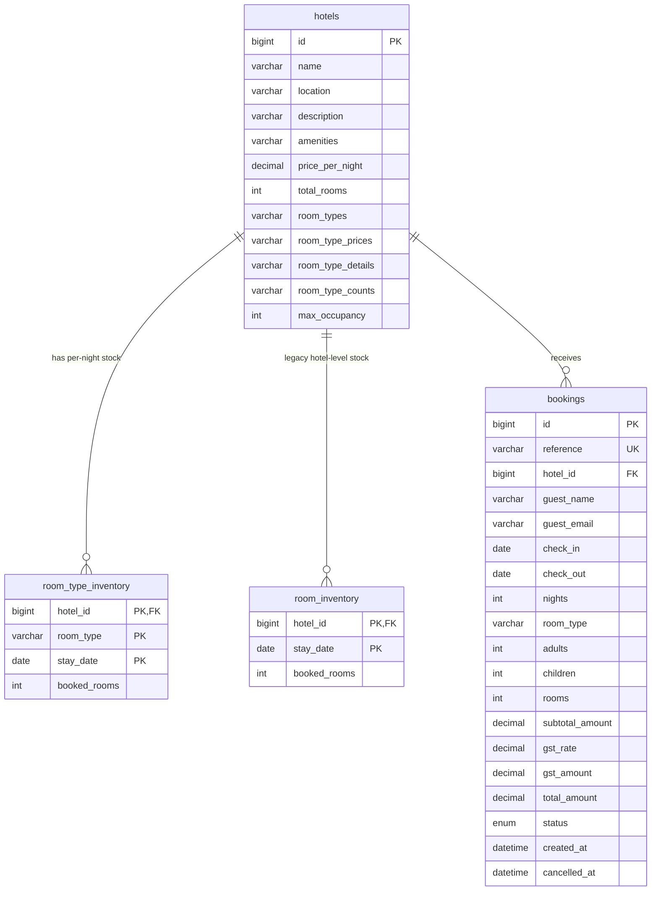

# Design Document

Hotel booking portal: React (Vite) frontend, Spring Boot REST API, MySQL 8.

This document explains how the system is built and why. Where a choice was a trade-off, the
alternative that was considered is named, so the decision can be defended.

## Contents

1. [Architecture](#1-architecture)
2. [Database design](#2-database-design)
3. [API design](#3-api-design)
4. [Booking logic](#4-booking-logic)
5. [Handling simultaneous bookings](#5-handling-simultaneous-bookings)
6. [Cancellation policy](#6-cancellation-policy)
7. [Features beyond the assignment](#7-features-beyond-the-assignment)
8. [Surprise feature: smart alternative dates](#8-surprise-feature-smart-alternative-dates)
9. [Design decisions and trade-offs](#9-design-decisions-and-trade-offs)
10. [Testing strategy](#10-testing-strategy)
11. [Limitations and future improvements](#11-limitations-and-future-improvements)

---

## 1. Architecture

```
┌────────────────────┐   HTTP / JSON   ┌───────────────────────────────┐   JDBC   ┌─────────┐
│  React (Vite)      │ ──────────────► │  Spring Boot REST API         │ ───────► │ MySQL 8 │
│  pages, components │ ◄────────────── │  controller → service → repo  │ ◄─────── │         │
└────────────────────┘                 └───────────────────────────────┘          └─────────┘
                                          Flyway runs migrations at startup
```

**Backend layers** (`com.hotelbooking`)

| Package | Responsibility |
|---|---|
| `controller` | HTTP only: parse input, call a service, return a DTO. No business rules. |
| `service` | All business rules: validation, pricing, availability, locking, cancellation. |
| `repository` | Spring Data JPA queries, including the `PESSIMISTIC_WRITE` lock queries. |
| `entity` | JPA entities mapped to the tables below. Never returned to the client. |
| `dto` / `mapper` | Request and response shapes; conversion from entities. |
| `exception` | Domain exceptions and one `GlobalExceptionHandler` for a uniform error body. |
| `config` | Typed business limits (`BookingRules`), CORS, and a `Clock` bean. |

**Frontend** is a thin client. It collects input, shows what the API returns, and does basic
UX validation. **The backend is the single source of truth** for prices, availability, and
cancellation rules. The client never calculates a total that the server then trusts.

**Configuration** comes from environment variables (`DB_URL`, `DB_USER`, `DB_PASSWORD`,
`APP_TIMEZONE`, `CORS_ALLOWED_ORIGIN`, `VITE_API_URL`). No credentials are stored in the
repository; `.env.example` files list the variable names only.

**Time handling.** A `Clock` bean (default zone `Asia/Kolkata`, configurable) is injected
wherever "today" or "now" is needed, which makes date rules deterministic in tests. Stay dates
are plain `LocalDate` values. Audit timestamps (`created_at`, `cancelled_at`) are stored in UTC.

---

## 2. Database design

### Entity-relationship diagram



### Tables

- **`hotels`** holds the catalogue: name, location, description, amenities, base price, total
  rooms, and the room-type metadata (see [section 9](#9-design-decisions-and-trade-offs)).
- **`room_type_inventory`** has one row per **hotel + room type + night**, with a
  `booked_rooms` counter. This is the table that bookings lock and update.
- **`room_inventory`** is the original per-hotel, per-night counter, kept from the first
  version of the schema.
- **`bookings`** stores the guest, the stay, the room type, guests and rooms, the price
  breakdown (`subtotal_amount`, `gst_rate`, `gst_amount`, `total_amount`), and the status.

### Why availability is stored per night

Availability is a counter per night, not "a list of bookings to count". This makes the
availability check a simple comparison per night, and it gives the database concrete rows to lock
when two users compete for the last room. The inventory is pre-seeded for the booking window
plus a 7-day buffer (`inventory-seed-days: 372`) and topped up by a scheduled job.

### Constraints that protect the data

| Constraint | Protects |
|---|---|
| `PRIMARY KEY (hotel_id, room_type, stay_date)` | One inventory row per room type per night |
| `UNIQUE (reference)` | No two bookings share a reference |
| Foreign keys to `hotels` | No orphan inventory or bookings |
| `CHECK (check_out > check_in)` | Valid date order |
| `CHECK (nights = DATEDIFF(check_out, check_in))` | Stored nights always match the dates |
| `CHECK (booked_rooms >= 0)` | Counters never go negative |
| `CHECK` on status and `cancelled_at` | A cancelled booking always has a cancel time, a confirmed one never does |
| Index `(reference, guest_email)` | Fast retrieval for the "manage booking" lookup |
| Index `(hotel_id, check_in, check_out)` | Fast date-range queries per hotel |

The upper bound (`booked_rooms <= capacity`) cannot be a `CHECK`, because it needs another
table's value. It is enforced in the service layer **while the rows are locked**
([section 5](#5-handling-simultaneous-bookings)).

### Migrations

Flyway owns the schema (`ddl-auto: none`). Migrations live in `db/migration` and are copied
into the backend build. Sample hotels are seeded by migration so a fresh database is usable
immediately. `db/setup/create-database.sql` creates the database and user (replace the
`CHANGE_ME` password first).

---

## 3. API design

REST and JSON, all under `/api`.

| Method | Endpoint | Purpose |
|---|---|---|
| `GET` | `/api/hotels?location=&checkIn=&checkOut=` | Search hotels; with dates, includes availability and a quote |
| `GET` | `/api/hotels/{id}?checkIn=&checkOut=&roomType=&rooms=` | Hotel details, room options, quote for the selected room type |
| `GET` | `/api/hotels/{id}/availability?from=&to=&roomType=` | Per-night availability level for the calendar |
| `GET` | `/api/hotels/{id}/alternatives?checkIn=&checkOut=` | Nearby available stays when the chosen dates are sold out |
| `POST` | `/api/bookings` | Create a booking; returns the reference and the full price breakdown |
| `GET` | `/api/bookings/{reference}?email=` | Retrieve a booking |
| `POST` | `/api/bookings/{reference}/cancel?email=` | Cancel a booking |

### Error handling

One `@RestControllerAdvice` returns the same body for every failure:
`{ timestamp, status, error, message, path, fieldErrors[] }`.

| Status | When |
|---|---|
| `400` | Validation failure: bad email, blank name, past check-in, check-out not after check-in, stay too long, outside the booking window |
| `404` | Unknown hotel, or booking reference/email mismatch |
| `409` | Sold out, or cancellation no longer allowed |
| `500` | Unexpected error; the response contains no stack trace |

**Security note on retrieval.** An unknown reference and a correct reference with the wrong
email both return the same `404`. An attacker cannot learn whether a reference exists.

**Why `POST .../cancel` and not `DELETE`.** Cancelling does not delete the row: it changes the
status and releases inventory, and the record stays for history. A state-changing `POST` models
that more honestly than `DELETE`.

---

## 4. Booking logic

### Date rules

- Check-out must be after check-in; check-in cannot be in the past (in the configured timezone).
- Maximum stay is 30 nights; bookings are accepted up to 365 days ahead. Both are configurable
  (`app.booking.max-nights`, `app.booking.window-days`).

### The overlap rule

A stay occupies the nights **`[check-in, check-out)`**: the check-out day is **not** a booked
night. Therefore a guest leaving on the 10th and another arriving on the 10th do not conflict,
and a sold-out check-out day is still valid as a check-out date.

### Pricing

```
subtotal = nights × nightly rate of the selected room type × rooms
gst      = subtotal × 18%
total    = subtotal + gst
```

- Calculated **only on the backend** with `BigDecimal`, rounded to 2 decimals (`HALF_UP`).
- Room prices are treated as GST-exclusive. GST is a flat 18% assumption, not a full tax engine.
- The breakdown (`subtotal_amount`, `gst_rate`, `gst_amount`) is saved on every booking, so
  historical bookings do not change if the rate changes later.
- The booking form shows the server-returned quote before the user confirms.

### Occupancy

Adults and children both count as one guest toward room capacity (no child-age policy). The
request is rejected if the guests exceed `max occupancy × rooms` for the chosen room type.

### Creating a booking (one transaction)

1. Validate the stay dates, the room type, the occupancy and the room count.
2. Lock the inventory rows for every night of the stay (ordered by date).
3. Check that every night has enough free rooms; if any night does not, reject with `409`.
4. Increment `booked_rooms` on every night by the number of rooms booked.
5. Generate a unique reference (`HB-XXXXXXXX`, random, not sequential), calculate the price,
   and insert the booking.

If any step fails, the whole transaction rolls back, so inventory and bookings never disagree.

### Cancelling a booking (one transaction)

1. Look up by reference **and** email, locking the booking row.
2. If already cancelled, return it unchanged. Cancelling is **idempotent** and releases nothing
   a second time.
3. Check the cancellation deadline ([section 6](#6-cancellation-policy)).
4. Lock the same inventory rows in the same order, decrement by the rooms booked, and mark the
   booking `CANCELLED` with a timestamp.

---

## 5. Handling simultaneous bookings

**The problem.** Two users book the last room at the same moment. A naive "read the count, then
write" lets both succeed and oversells the room.

**The solution.** Booking and cancellation use **pessimistic locking**:

```java
@Lock(LockModeType.PESSIMISTIC_WRITE)   // SELECT ... FOR UPDATE
List<RoomTypeInventory> findStayForUpdate(hotelId, roomType, startDate, endDate);
```

The first transaction locks the nights it needs. The second waits, then re-reads the updated
counts, sees no room left, and is rejected with `409`. Exactly one booking wins.

**Deadlock prevention.** Every transaction locks its rows **ordered by `stay_date`**. Because all
transactions acquire locks in the same order, two overlapping stays cannot wait on each other in
a cycle. Cancellation locks the booking row first and then the inventory rows, and booking only
locks inventory rows, so the two paths cannot form a cycle either.

**Failure mode on purpose.** If an inventory row is missing for a night, the service throws
instead of booking silently. Validation and the seeder should make this impossible, so it is
treated as a server error that must be noticed.

### Alternatives considered

| Approach | Why it was not chosen |
|---|---|
| Optimistic locking (`@Version`) | Under contention on the last room, most requests would fail and need retry logic. Pessimistic locking queues them instead. |
| `SERIALIZABLE` isolation | Correct, but locks far more than needed and is harder to reason about and tune. |
| Lock one row per hotel | Simpler, but it serializes *all* bookings for a hotel, even for different dates. |
| Single conditional `UPDATE ... WHERE booked_rooms < capacity` per night | Works for one night, but a multi-night stay needs all-or-nothing across rows, which needs the transaction anyway. |
| Count overlapping bookings instead of storing counters | Requires locking something to be safe, and the count gets slower as bookings grow. |

**Trade-off accepted.** Pessimistic locks hold rows for the duration of the transaction. The
transactions here are short (one indexed range lock plus one insert), so contention is low for
this scale.

---

## 6. Cancellation policy

Cancellation is allowed until **48 hours before 00:00 on the check-in date** (in the configured
timezone). If a booking is made *inside* that window, the guest gets a short **grace period**
(2 hours after booking), capped at the start of check-in day.

- After the deadline the API returns `409` with a clear message.
- The booking response includes `cancellable` (boolean) and `cancellableUntil` (timestamp), so
  the UI can disable the button and explain why instead of letting the user hit an error.
- The hours are configuration (`free-cancellation-hours`, `cancellation-grace-hours`).
- There are no fees or refunds, because there are no payments in this project.

**Why a grace period exists.** Without it, a booking made for tomorrow would be impossible to
cancel from the first second, which punishes mistakes such as a wrong date or a typo.

---

## 7. Features beyond the assignment

These were added on top of the required scope. Each has limits, listed in
[section 11](#11-limitations-and-future-improvements).

| Feature | What it does |
|---|---|
| **GST breakdown** | Shows subtotal, GST and total; the breakdown is stored with each booking. |
| **48-hour cancellation rule** | Time-limited cancellation with a grace period; driven by the API response. |
| **Room types** | Each hotel offers several room categories with their own price, stock and capacity; availability is tracked per category. |
| **Guests and rooms** | Adults, children and room count are validated, priced and stored. |
| **Availability calendar** | A month view shows per-night availability (available, limited, sold out) to help pick dates. |
| **"Rooms left" indicator** | Shows how many rooms remain for the selected dates. |
| **Hotel images** | Local WebP images, lazy-loaded, with descriptive alt text. |

---

## 8. Surprise feature: smart alternative dates

**What it does.** When the chosen dates are sold out, the user sees the nearest available stays
with the **same number of nights**, shifted up to 7 days earlier or later, each with its total
price and a one-click "use these dates" action.

**Why this feature.** A "sold out" message ends the user's search. Suggesting nearby dates keeps
them in the booking flow, which is the behaviour a real booking site optimises for. It is also
small, and it reuses the same availability rules as real bookings.

**How it works.**

1. One query loads the inventory for the whole window (`checkIn − 7` to `checkOut + 7`).
2. Candidate start dates are generated nearest first: −1, +1, −2, +2 … up to ±7 days. On a tie,
   the earlier date comes first.
3. Each candidate is checked **in memory** with the same availability and pricing code that a
   real booking uses, so a suggestion can never contradict the booking rules.
4. The first 3 bookable candidates are returned.

**Why in-memory instead of one query per candidate.** Up to 14 candidates would mean up to 14
database round trips. One range query plus a loop is faster and simpler.

---

## 9. Design decisions and trade-offs

| Decision | Reason | Trade-off |
|---|---|---|
| Per-night inventory counters | Simple checks and concrete rows to lock | A row for every night of every room type; needs seeding and top-up |
| Pessimistic locking | Predictable behaviour for the last-room case | Rows are held while the transaction runs |
| Check-out day is not a booked night | Matches how hotels work; allows back-to-back stays | Must be explained, because it surprises some people |
| Server-side pricing | The client cannot tamper with the total | The UI must wait for the quote before it can show a price |
| Price breakdown stored per booking | Old bookings stay correct if the rate changes | Three extra columns |
| `404` for a wrong email | Prevents reference guessing | Slightly less specific error message |
| `Clock` bean | Date rules are testable | One more bean to inject |
| Business limits in configuration | Change limits without code changes | Values must stay consistent (for example, seed days ≥ window days; this is validated at startup) |
| Room metadata as delimited strings | Kept the sample data and the original schema working with a small migration | Not normalised; see below |

**Room metadata in delimited columns.** Room-type names, prices, details and counts are stored
as delimited strings on `hotels` (for example `Deluxe=7500,Standard=6500`) and parsed in code,
which validates unknown, duplicate and malformed values. Availability itself is stored in proper
rows (`room_type_inventory`). The cleaner design is a `room_types` table
(`id, hotel_id, name, price, total_rooms, max_guests, bed_type, description`), with inventory
and bookings referencing `room_type_id` instead of the name. It was not done here to keep the
migration footprint small; it is the first improvement listed below.

---

## 10. Testing strategy

| Level | What is covered |
|---|---|
| Unit (JUnit 5 + Mockito) | Night counting and price calculation, GST rounding, date validation, overlap and back-to-back stays, sold-out detection, cancellation and release of inventory, repeated cancellation, reference generation, alternative dates |
| Integration (real MySQL test schema) | Full flow: book → retrieve → cancel; **concurrent requests for the last room, asserting exactly one succeeds**; inventory seeding is idempotent |

The test database is a separate schema (configured through `TEST_DB_URL`), so tests never touch
development data. Time-dependent rules use a fixed `Clock`, which keeps tests deterministic.

---

## 11. Limitations and future improvements

**Known limitations**

- **Room types are not normalised.** Names are free text in `room_type_inventory` and
  `bookings`; renaming a type would orphan inventory. Metadata lives in delimited strings.
- **GST is a flat 18%.** Real hotel GST depends on the room tariff slab. This is a documented
  assumption, not tax advice.
- **Booking lookup uses the email in the query string**, which can appear in server and proxy
  logs. Acceptable for the assignment; a `POST` lookup or a signed link is better.
- **No idempotency key on booking.** The UI disables the button while submitting, but a repeated
  request from a script could create a second booking.
- **Capacity is enforced in the service layer**, not by a database constraint, because a `CHECK`
  cannot read another table.
- **No authentication, payments, admin tools or deployment.** These were out of scope.
- **Children count as full guests.** There is no child-age policy.
- **Hotel images are project assets.** Confirm usage rights or replace them before publishing.

**Future improvements**

1. Normalise room types (`room_types` table; inventory and bookings reference its id).
2. Map lock timeouts and deadlocks to a clear "please retry" response (`409` or `503`).
3. Add an idempotency key to `POST /api/bookings`.
4. Tax rules by tariff slab, stored per hotel.
5. Add email confirmation with the booking reference.
6. Add authentication, so a user sees all of their own bookings.
7. Add a frontend test suite and an end-to-end test of the booking flow.